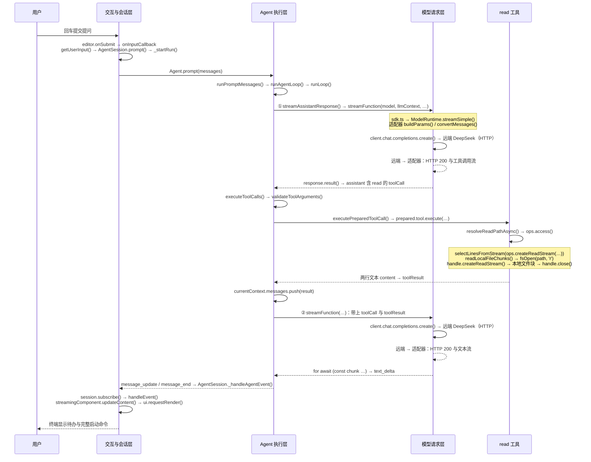
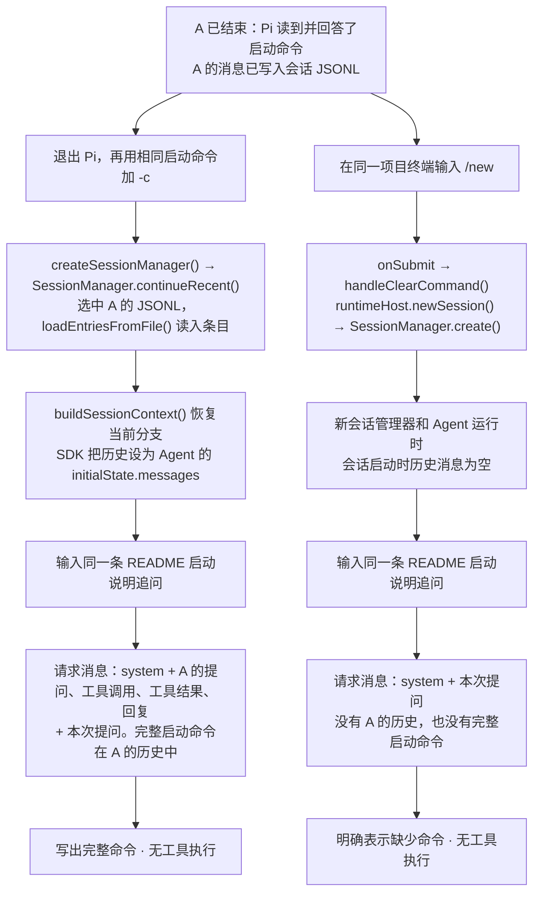

# 实践 05｜Pi Agent 工具调用与会话恢复

龚健（`gongjian`）｜2026 年 11 月 26 日

实验使用 Windows 上的本地构建产物 `packages/coding-agent/dist/cli.js`，Pi 版本为 `1.5.2`，Node.js 版本为 `v24.18.0`。三次提问均使用 `deepseek/deepseek-flash`，思考级别为 `off`。源码行号固定到本次实际运行的[小组源码提交 `c3cc916`](https://github.com/shizishizi111/pi-hunnu-2026/tree/c3cc91632d0a1950fb122605b190233f2aa0006e)。

三次交互使用同一个实验工作目录、同一个会话存储目录，均保留 `read` 作为可调用工具。实验使用真实 Pi 交互终端，退出后以相同参数加 `-c` 重启，再在该终端输入 `/new`。实验关闭扩展自动发现、MCP、技能、提示词模板及上下文文件加载，并显式加载观察扩展。`--offline` 用于关闭启动时的联网操作，三次提问仍请求了远程模型。观察扩展仅记录会话角色、标识是否出现在请求消息中、HTTP 状态和工具事件。原始事件摘要见[运行记录](./practice-05-trace.jsonl)。

## A. 单轮交互与工具调用

在工作目录创建 `handoff.txt`，写入以下内容。`cedar-358910` 是本次实验标识，只写进文件，提问未提供该标识或启动命令。

```text
待办：补充 README 的启动说明
启动命令：npm run demo -- --profile cedar-358910
```

交互终端输入：

> 请用 read 工具读取当前目录的 handoff.txt，原样告诉我待办和启动命令。

Pi 最终回复：

> `handoff.txt` 内容如下：
>
> **待办：** 补充 README 的启动说明  
> **启动命令：** `npm run demo -- --profile cedar-358910`

模型请求与工具执行的观察顺序如下。两次模型请求均收到 HTTP 200，`read` 的结束事件记录 `isError: false`。

| 顺序 | 事件 | 观察结果 |
| --- | --- | --- |
| 1 | 第一次模型请求 | 请求角色为 `system → user`，消息中无实验标识。模型返回对 `handoff.txt` 的 `read` 调用。 |
| 2 | 执行一次 `read` | 本地工具读取文件，`toolResult` 中含原始两行。 |
| 3 | 第二次模型请求 | 请求角色为 `system → user → assistant → tool`。新增条目分别是模型的工具调用和 Pi 的工具结果，请求消息首次包含实验标识。 |
| 4 | 最终回复 | 模型返回待办和完整命令，终止原因为 `stop`。 |

### 图 1. 单轮工具调用的代码级时序图



观察到的工具调用参数为 `{"path":"handoff.txt","offset":null,"limit":null}`。`offset` 和 `limit` 是可选参数，进入工具执行前经 `validateToolArguments()` 将这两个不接受 `null` 的可选字段按缺省处理。普通文本且未指定范围时，默认实现使用 `selectLinesFromStream()` 消费 `readLocalFileChunks()` 生成的文件块。图中按实测参数和默认实现定位到这条分支，`ops.readFile()` 是此处未走的缓冲区分支。远程模型生成工具调用并读取返回文本，打开本地文件的是 Pi 的 `read` 工具。

| 职责 | 源码位置 |
| --- | --- |
| 普通输入由回调交给主循环，主循环调用 `session.prompt()` | [编辑器提交回调](https://github.com/shizishizi111/pi-hunnu-2026/blob/c3cc91632d0a1950fb122605b190233f2aa0006e/packages/coding-agent/src/modes/interactive/interactive-mode.ts#L3511-L3521) · [主循环](https://github.com/shizishizi111/pi-hunnu-2026/blob/c3cc91632d0a1950fb122605b190233f2aa0006e/packages/coding-agent/src/modes/interactive/interactive-mode.ts#L1292-L1301) · [会话启动 Agent](https://github.com/shizishizi111/pi-hunnu-2026/blob/c3cc91632d0a1950fb122605b190233f2aa0006e/packages/coding-agent/src/core/agent-session.ts#L1956-L1983) |
| Agent 循环、组装请求、工具结果写回 | [Agent.prompt()](https://github.com/shizishizi111/pi-hunnu-2026/blob/c3cc91632d0a1950fb122605b190233f2aa0006e/packages/agent/src/agent.ts#L382-L390) · [调用 runAgentLoop()](https://github.com/shizishizi111/pi-hunnu-2026/blob/c3cc91632d0a1950fb122605b190233f2aa0006e/packages/agent/src/agent.ts#L441-L455) · [工具结果写回](https://github.com/shizishizi111/pi-hunnu-2026/blob/c3cc91632d0a1950fb122605b190233f2aa0006e/packages/agent/src/agent-loop.ts#L251-L288) · [streamFunction()](https://github.com/shizishizi111/pi-hunnu-2026/blob/c3cc91632d0a1950fb122605b190233f2aa0006e/packages/agent/src/agent-loop.ts#L390-L423) |
| 默认 `read` 的参数校验、文件读取 | [参数校验](https://github.com/shizishizi111/pi-hunnu-2026/blob/c3cc91632d0a1950fb122605b190233f2aa0006e/packages/ai/src/utils/validation.ts#L46-L69) · [工具执行](https://github.com/shizishizi111/pi-hunnu-2026/blob/c3cc91632d0a1950fb122605b190233f2aa0006e/packages/agent/src/agent-loop.ts#L824-L850) · [文件流实现](https://github.com/shizishizi111/pi-hunnu-2026/blob/c3cc91632d0a1950fb122605b190233f2aa0006e/packages/coding-agent/src/core/tools/read.ts#L68-L91) · [文本分支选择](https://github.com/shizishizi111/pi-hunnu-2026/blob/c3cc91632d0a1950fb122605b190233f2aa0006e/packages/coding-agent/src/core/tools/read.ts#L295-L309) |
| 模型请求与终端回复 | [SDK 请求入口](https://github.com/shizishizi111/pi-hunnu-2026/blob/c3cc91632d0a1950fb122605b190233f2aa0006e/packages/coding-agent/src/core/sdk.ts#L411-L425) · [HTTP 调用](https://github.com/shizishizi111/pi-hunnu-2026/blob/c3cc91632d0a1950fb122605b190233f2aa0006e/packages/ai/src/api/openai-completions.ts#L365-L394) · [响应流消费](https://github.com/shizishizi111/pi-hunnu-2026/blob/c3cc91632d0a1950fb122605b190233f2aa0006e/packages/ai/src/api/openai-completions.ts#L533-L549) · [界面订阅](https://github.com/shizishizi111/pi-hunnu-2026/blob/c3cc91632d0a1950fb122605b190233f2aa0006e/packages/coding-agent/src/modes/interactive/interactive-mode.ts#L3525-L3538) · [回复渲染](https://github.com/shizishizi111/pi-hunnu-2026/blob/c3cc91632d0a1950fb122605b190233f2aa0006e/packages/coding-agent/src/modes/interactive/interactive-mode.ts#L3649-L3722) |

## B. 恢复旧会话和新建会话

退出 Pi 后，在同一工作目录用原启动参数加 `-c` 重启。提问前，终端已重新显示 A 阶段的历史，其中能看到 `handoff.txt` 的读取记录和完整启动命令。完成第一次追问后，在同一进程输入 `/new`，确认终端显示 `New session started`，然后再次发送完全相同的文字：

> 接着上次的待办，给 README 起草一条启动说明，写出交接单里的完整启动命令。只用这次会话已有的信息。不要调用工具。如果缺少命令，请直接说明。

| 条件 | 实际回答（节选） | 请求次数 | 工具执行 |
| --- | --- | ---: | --- |
| `-c` 恢复旧会话 | “在项目目录下运行：” `npm run demo -- --profile cedar-358910`。回复另说明缺少前置安装等上下文。 | 1 | 0 |
| `/new` 新建会话 | “据我目前掌握的信息，无法确定交接单里的启动命令——这次会话里没有出现交接单内容，我也没有读取过任何文件。” | 1 | 0 |

### 图 2. 恢复旧会话与新建会话的请求内容对照



`-c` 恢复的是 A 的 JSONL 当前分支。`AgentSession._handleAgentEvent()` 在 `message_end` 时调用 `appendMessage()`，会保存用户消息、模型工具调用、工具结果和最终回复。启动恢复时由 `buildSessionContext()` 投影这些条目，SDK 用所得消息初始化 Agent。模型适配器把 Pi 内部的 `toolResult` 转成请求中的 `tool`。恢复后，实测请求角色为 `system → user → assistant → tool → assistant → user`，其中最后一个 `user` 是追问。

`/new` 由交互界面处理，在相同会话目录下创建独立会话管理器和运行时。新会话的启动事件中 `history` 为 `[]`。追问发出时，请求里仍有 `system`，但聊天消息只有本次 `user`。日志显示两次追问都没有新的工具事件，且只有恢复分支的请求消息带有实验标识。这支持本次恢复分支从已保存的会话历史获得命令。

| 职责 | 源码位置 |
| --- | --- |
| 将聊天和工具结果保存为会话条目 | [message_end → appendMessage()](https://github.com/shizishizi111/pi-hunnu-2026/blob/c3cc91632d0a1950fb122605b190233f2aa0006e/packages/coding-agent/src/core/agent-session.ts#L1212-L1234) |
| `-c` 找最近会话并恢复消息 | [CLI 恢复分支](https://github.com/shizishizi111/pi-hunnu-2026/blob/c3cc91632d0a1950fb122605b190233f2aa0006e/packages/coding-agent/src/main.ts#L479-L481) · [continueRecent()](https://github.com/shizishizi111/pi-hunnu-2026/blob/c3cc91632d0a1950fb122605b190233f2aa0006e/packages/coding-agent/src/core/session-manager.ts#L1811-L1819) · [JSONL 加载](https://github.com/shizishizi111/pi-hunnu-2026/blob/c3cc91632d0a1950fb122605b190233f2aa0006e/packages/coding-agent/src/core/session-manager.ts#L628-L648) · [SDK 读取会话历史](https://github.com/shizishizi111/pi-hunnu-2026/blob/c3cc91632d0a1950fb122605b190233f2aa0006e/packages/coding-agent/src/core/sdk.ts#L209-L212) · [注入 Agent 初始状态](https://github.com/shizishizi111/pi-hunnu-2026/blob/c3cc91632d0a1950fb122605b190233f2aa0006e/packages/coding-agent/src/core/sdk.ts#L402-L410) |
| `/new` 创建并切换新会话 | [斜杠命令分支](https://github.com/shizishizi111/pi-hunnu-2026/blob/c3cc91632d0a1950fb122605b190233f2aa0006e/packages/coding-agent/src/modes/interactive/interactive-mode.ts#L3428-L3433) · [handleClearCommand()](https://github.com/shizishizi111/pi-hunnu-2026/blob/c3cc91632d0a1950fb122605b190233f2aa0006e/packages/coding-agent/src/modes/interactive/interactive-mode.ts#L7117-L7129) · [运行时 newSession()](https://github.com/shizishizi111/pi-hunnu-2026/blob/c3cc91632d0a1950fb122605b190233f2aa0006e/packages/coding-agent/src/core/agent-session-runtime.ts#L226-L258) |

## 修改位置

按功能边界定位修改点。要调整 `read` 的行范围或截断逻辑，从 `core/tools/read.ts` 的 `createReadToolDefinition()` 入手。要修改终端对流式回复的展示，定位到 `interactive-mode.ts` 的 `handleEvent()`。要改变恢复时选哪个会话，定位到 `main.ts` 的 `createSessionManager()` 和 `session-manager.ts` 的 `continueRecent()`。如果选中的文件正确、但进入模型请求的历史有偏差，则先检查 `buildSessionContext()` 与 SDK 对 `initialState.messages` 的赋值。
